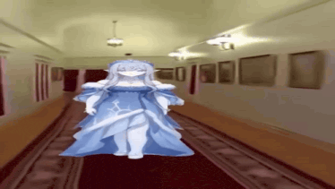

<h1 align="center">Hey, I'm Capy</h1>

  

 

<h3 align="center">Tech stack</h3>

  

 

<h3 align="center">Favorite repo</h3>

  

 

  Server is free of use, but if you appreciate my work, you can always donate :&gt;

  <a href="https://ko-fi.com/capyb2222">https://ko-fi.com/capyb2222</a>

